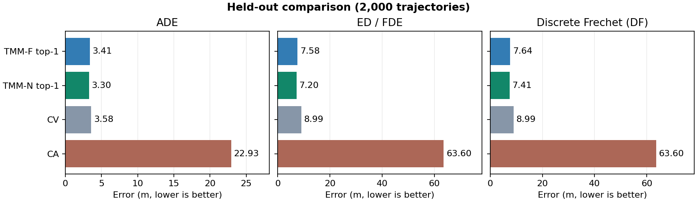

# TMM: Multi-Modal 3D Trajectory Prediction

This repository provides an offline synthetic benchmark for the Trajectory Mapping Model (TMM). It includes **TMM-F**, **TMM-N**, and two kinematic baselines: constant velocity (**CV**) and constant acceleration (**CA**). No external datasets or pretrained weights are required.



## Model

```text
50 observed 3D positions
  → Coordinate preprocessing (TMM-F: raw; TMM-N: normalized)
  → Discrete Fréchet distances, greedy reference selection, and RBF features
  → Two MLP-Mixer blocks and a mixture density network (MDN)
  → Sample RBF trajectory coefficients and decode 25 future positions
  → Cluster trajectory endpoints with a Gaussian mixture model (GMM)
  → Output candidate trajectories and their probabilities
```

TMM-F and TMM-N share the same network architecture but select their reference trajectories, train, and choose their best epochs independently. TMM-F uses the original coordinates. TMM-N estimates translation, rotation, and scale from the observed segment, then converts its predictions back to the original coordinates in meters.

## 1. Set up the environment

Run all commands from the repository root, where `train.py` is located. If you already have a `ktm` environment with the project dependencies installed, activate it and check whether PyTorch can use CUDA:

```sh
conda activate ktm
python -c "import torch; print(torch.__version__, 'CUDA:', torch.cuda.is_available())"
```

Otherwise, use Conda to create a Python 3.10 environment:

```sh
conda create -n tmm python=3.10 pip -y
conda activate tmm
```

On Windows or Linux, run **one** of the following commands. Use the CPU build if you do not have a compatible NVIDIA GPU. The CUDA build requires a driver compatible with CUDA 11.8. See the [official PyTorch 2.7.0 installation instructions](https://pytorch.org/get-started/previous-versions/#v270).

```sh
# CPU
python -m pip install torch==2.7.0 --index-url https://download.pytorch.org/whl/cpu

# Or CUDA 11.8
python -m pip install torch==2.7.0 --index-url https://download.pytorch.org/whl/cu118
```

Install the remaining dependencies and verify the environment:

```sh
python -m pip install -r requirements.txt
python -c "import numpy, numba, sklearn, matplotlib, torch; print(torch.__version__, 'CUDA:', torch.cuda.is_available())"
```

The reported results were obtained on Windows with Python 3.10, PyTorch 2.7.0 + CUDA 11.8, and an NVIDIA GeForce RTX 4060 Laptop GPU. CPU execution is supported. The fixed seed controls data generation, splits, model initialization, batch ordering, and trajectory sampling; it does not guarantee bit-for-bit reproducibility across hardware or dependency versions.

## 2. Prepare the data

Use the bundled `data/trajectories.npz`, or regenerate it with:

```sh
python generate_trajectories.py --count 10000 --seed 42 --noise-std 0.05
```

These are also the generator defaults. The dataset contains 10,000 synthetic 3D trajectories with straight flight, gentle turns, or sharp turns, sampled every **0.2 seconds**. Independent zero-mean Gaussian noise with a **standard deviation of 0.05 m per axis** is added to each observed position. The future ground-truth positions are noise-free.

| Array | Shape | Description |
| --- | --- | --- |
| `observations` | `(10000, 50, 3)` | Noisy historical positions in meters |
| `predictions` | `(10000, 25, 3)` | Noise-free future ground truth over a 5-second horizon |
| `kinds` | `(10000,)` | Motion category |

## 3. Train and evaluate

**Smoke test:** Use 512 trajectories and 3 epochs per model to check the environment and output files. Do not compare these scores with the full benchmark.

```sh
python train.py --variant both --seed 42 --epochs 3 --max-trajectories 512 --val-cases 12 --val-samples 48 --samples 80 --output-dir runs/smoke
```

**Full benchmark:** Train each variant for 50 epochs with a shared split of 7,000 training, 1,000 validation, and 2,000 test trajectories:

```sh
python train.py --variant both --seed 42 --epochs 50 --output-dir runs/benchmark
```

To run either variant independently:

```sh
python train.py --variant f --seed 42 --epochs 50 --output-dir runs/only_f
python train.py --variant n --seed 42 --epochs 50 --output-dir runs/only_n
```

- By default, the script uses CUDA if available and falls back to CPU. Use `--device cpu` to force CPU or `--device cuda` to require CUDA.
- Use `--data` to point to another `.npz` produced by the generator. Reference trajectories come only from the training set. Fréchet distance preprocessing runs on CPU; the full training distance matrix occupies about 374 MiB per variant.
- By default, the script samples 300 predictions for each test trajectory and clusters their endpoints with a GMM. Each variant independently selects the epoch with the lowest probability-weighted validation DF (`M-DF`) before evaluating it on the held-out test set.

## 4. Read the logs and results

The console reports the device, seed, split sizes, and preprocessing and training progress for each variant. `train NLL` and `val NLL` are mixture negative log-likelihoods on the training and validation sets; `val M-DF` is probability-weighted validation discrete Fréchet distance in meters. The script then prints the best epochs, test scores, and output directory.

| Output | Description |
| --- | --- |
| `runs/benchmark/metrics.json` | Run configuration, split sizes, best epochs, and test scores |
| `runs/benchmark/comparison.png` | Test scores for both TMM variants' top-1 predictions, CV, and CA |
| `runs/benchmark/tmm-f/` | TMM-F's `history.csv`, `learning_curves.png`, and `trajectory.png` |
| `runs/benchmark/tmm-n/` | The same training history and figures for TMM-N |

### Metrics

| Metric | Definition |
| --- | --- |
| **ADE** | Average displacement error: the mean Euclidean distance between corresponding predicted and ground-truth points over all 25 future steps |
| **ED / FDE** | Final displacement error: the Euclidean distance at the last prediction step. This is called ED in the paper and stored as `ED` in the JSON output |
| **DF** | Discrete Fréchet distance between the predicted and ground-truth trajectories, which compares their overall shape while preserving point order |

All three metrics are reported in meters and averaged over the test trajectories. Lower is better. TMM's multi-modal predictions are evaluated in three ways:

- **top-1:** Score only the candidate trajectory with the highest predicted probability.
- **weighted:** For each test trajectory, weight candidate errors by their probabilities, then average across test trajectories. ED and DF correspond to M-ED and M-DF in the paper.
- **oracle:** For each metric, score the candidate with the smallest error against the ground truth. ED and DF correspond to B-ED and B-DF in the paper. This measures candidate quality; it is not a selection rule available at inference time.

### Benchmark results: 5 cm observation noise

Both variants trained for 50 epochs. The selected epochs were 50 for TMM-F and 14 for TMM-N. All methods were evaluated on the same 2,000 test trajectories.

| Method | ADE (m) ↓ | ED / FDE (m) ↓ | DF (m) ↓ |
| --- | ---: | ---: | ---: |
| TMM-F top-1 | 3.41 | 7.58 | 7.64 |
| **TMM-N top-1** | **3.30** | **7.20** | **7.41** |
| CV | 3.58 | 8.99 | 8.99 |
| CA | 22.93 | 63.60 | 63.60 |

TMM-N's top-1 prediction has the lowest error across all three metrics in this benchmark. CA estimates acceleration with a second difference over the last three observations without smoothing. This estimate is sensitive to noise, and extrapolation amplifies the error over time.

| Variant | Predicted trajectories | Training curves |
| --- | --- | --- |
| TMM-F | [Trajectory example](assets/tmm_f_example.png) | [Learning curves](assets/tmm_f_learning_curves.png) |
| TMM-N | [Trajectory example](assets/tmm_n_example.png) | [Learning curves](assets/tmm_n_learning_curves.png) |

Both trajectory figures show the same test example: noisy observations, noise-free ground truth, TMM candidates and their probabilities, and the CV and CA predictions. The [full benchmark metrics](assets/benchmark_5cm.json) include top-1, weighted, and oracle scores.

## Repository layout

| Path | Purpose |
| --- | --- |
| `generate_trajectories.py` | Generate synthetic observations and future ground truth with a fixed seed |
| `train.py` | Split the data, train the variants independently, select checkpoints in memory, and evaluate |
| `tmm.py` | MLP-Mixer, MDN, kernel ridge regression for trajectory coefficients, and multi-modal decoding |
| `geometry.py` | Coordinate transforms, discrete Fréchet distance, reference selection, and CV / CA |
| `report.py` | Generate training curves, trajectory examples, and comparison plots |
| `data/` | Bundled synthetic trajectories |
| `assets/` | Benchmark JSON and published result figures |

Local outputs in `runs/` are ignored by Git. The repository does not distribute legacy datasets, preprocessing caches, or model weights. To save the console log in Bash or PowerShell, append `2>&1 | tee benchmark.log` to the training command.

## Citation

J. Ma et al., *TMM: Trajectory Mapping Model Framework for Multi-Modal Probabilistic UAV Motion Prediction*, IEEE Robotics and Automation Letters. DOI: [10.1109/LRA.2026.3748666](https://doi.org/10.1109/LRA.2026.3748666).
